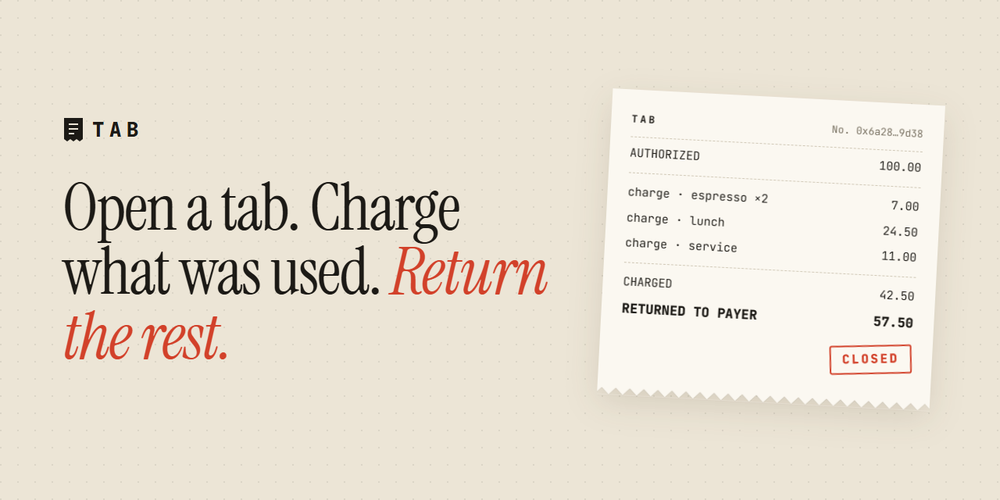
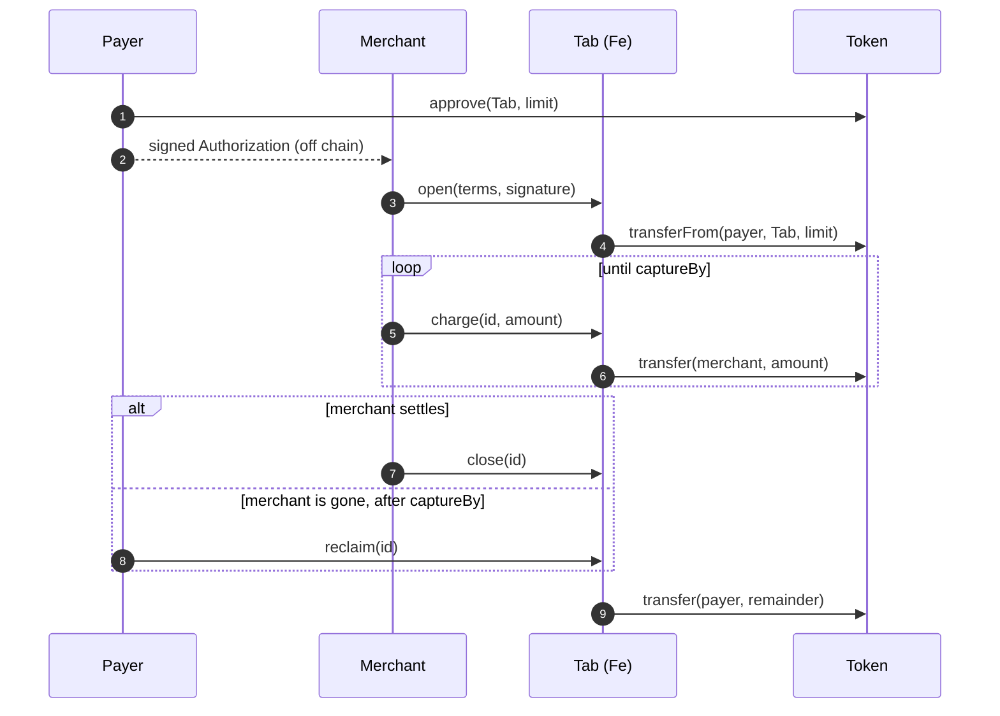
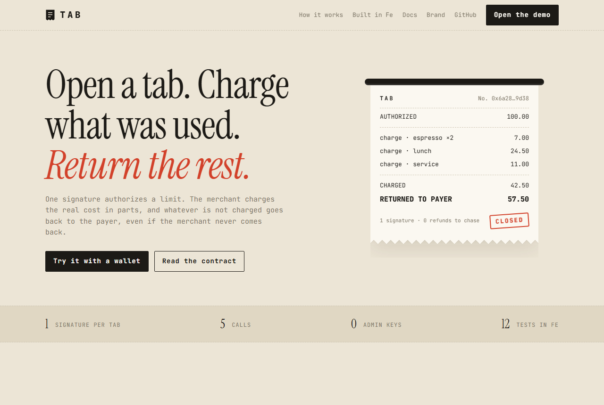
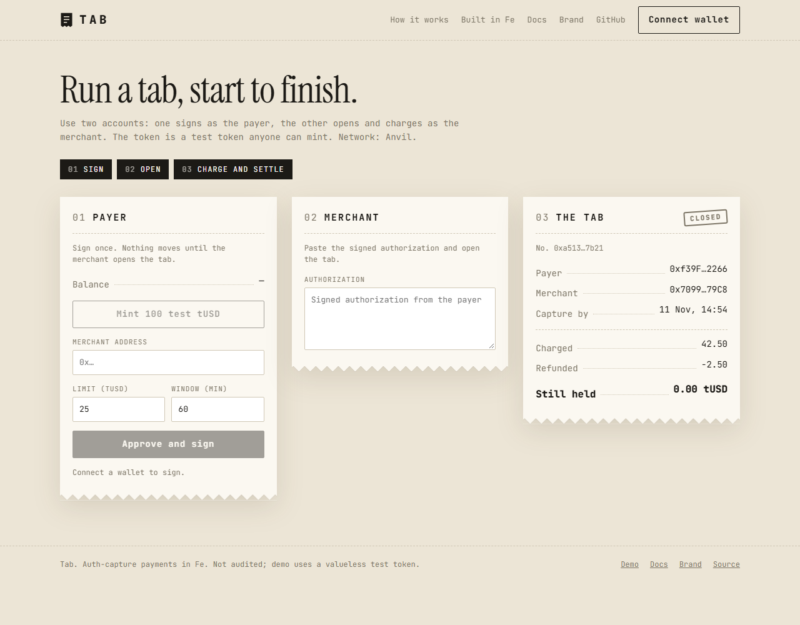

<p align="center">
  
</p>

<p align="center">
  <a href="https://github.com/enliven17/tab/actions/workflows/ci.yml"></a>
  
  
  
</p>

# Tab

**Pitch:** Tab is an auth-capture payment escrow in Fe: one signature opens a tab, the merchant charges it in parts, and whatever is not charged goes back to the payer.

- [The problem](#the-problem)
- [Approach](#approach)
- [Fe highlight](#fe-highlight)
- [Architecture](#architecture)
- [Build and test](#build-and-test)
- [Demo](#demo)
- [Limitations](#limitations)
- [Declaration](#declaration)

## The problem

Card payments separate authorization from capture: a hotel, a ride or a metered API holds an amount first and charges the real cost later. On-chain payments usually move the full amount at once, so the payer either overpays and waits for a refund or signs again for every charge. The x402 `auth-capture` scheme describes the two-step flow for HTTP payments; Tab is an implementation of that flow in Fe.

| | Pay upfront | With a tab |
| --- | --- | --- |
| Moves at the start | 100.00 to the merchant | 100.00 into escrow |
| Real cost | 42.50 | 42.50 charged |
| The other 57.50 | Returned when the merchant sends it | Returned by the contract |
| Payer signatures | One per payment | One per tab |

## Approach

The payer signs a single EIP-712 `Authorization` (payer, merchant, token, limit, `openBy`, `captureBy`, nonce). Anyone can submit it.



| Call | Who | Effect |
| --- | --- | --- |
| `open` | anyone, before `openBy` | Verifies the signature (EOA or ERC-1271) and moves `limit` from the payer into escrow. Returns the tab id. |
| `charge` | merchant, until `captureBy` | Sends part of the held amount to the merchant. Can be called repeatedly. |
| `close` | merchant | Returns the held remainder to the payer. |
| `reclaim` | anyone, after `captureBy` | Returns the held remainder to the payer. |
| `refund` | merchant | Sends previously charged funds back to the payer, up to the charged total. |

The tab id is the EIP-712 digest of the authorization. A signed authorization therefore opens exactly one tab, and replay protection needs no separate nonce storage.

## Fe highlight

Every handler lists the state and capabilities it may touch, and the compiler enforces the list. `refund` cannot change the held balance, and `digest` cannot write storage or make calls, because neither names those effects:

```fe
Refund { id, amount } uses (ctx, mut call, terms, charged, mut refunded, mut log) {
    ...
}

Digest { payer, merchant, token, limit, open_by, capture_by, nonce } -> u256
    uses (ctx, domain)
{
    ...
}
```

In Solidity the same guarantee is a convention checked by reviewers. Here a write to `held` inside `refund` does not compile:

```
error[8-0116]: contract field `held` is not in this handler's `uses`
    │
276 │             held.set(key: id, value: 0)
    │             ^^^^ `held` is not reachable here
```

## Architecture

```
src/
  lib.fe          Tab escrow, TabMsg ABI, authorization_hash
  demo_token.fe   mintable test token for the demo deployment
  tests.fe        flow tests, revert tests, typed-data vector test
web/
  src/tab.ts      ABI, EIP-712 typed data, authorization encoding
  src/landing/    landing page          /
  src/app/        demo with a wallet    /app/
  src/docs/       documentation         /docs/
  src/brand/      brand kit             /brand/
  scripts/        deploy.ts, e2e.ts
```

- `authorization_hash` builds the EIP-712 struct hash with `keccak_words`.
- `Tab` writes the terms once per tab; `held`, `charged` and `refunded` are separate maps.
- Signature checks and token transfers use the Fe standard library (`std::evm::eip712`, `std::evm::signature`, `std::evm::erc20`).
- The tests use a `Wallet` contract (an ERC-1271 payer) and a `Stranger` contract as actors, and check the struct hash, digest and signer against values produced by Foundry's `cast` from the same typed data.

## Build and test

```sh
fe --version   # fe 26.6.0
fe test
fe build
```

The contracts need no other tools; the web demo needs Node 24, pnpm and Foundry's `anvil`. The test vectors were generated with Foundry (`cast`), which is not required to run the tests.

## Demo

`fe test` runs the flows end to end against deployed contracts: a wallet signs an authorization, the merchant opens the tab, charges it in parts, closes it, and refunds part of a charge.

### Web

`web/` holds four static pages: a landing page, a demo for a real wallet, the documentation and the brand kit. In the demo the payer mints test tokens and signs, and the merchant opens, charges, closes and refunds.

| Landing | Demo |
| --- | --- |
|  |  |

```sh
anvil                      # local chain, in another terminal
fe build
cd web && pnpm install
pnpm run deploy            # deploys Tab and DemoToken, writes src/deployment.json
pnpm run e2e               # scripted flow with Anvil accounts 0 and 1
pnpm dev
```

`pnpm run e2e` signs real typed data, opens a tab, charges it twice, closes it and refunds part of a charge, asserting every balance. `pnpm run deploy` reads `RPC_URL` and `PRIVATE_KEY` to deploy to another network.

## Limitations

- Not audited. Do not use with real funds.
- Fee-on-transfer and rebasing tokens are not supported: the contract assumes the escrow receives exactly `limit`.
- The payer must approve the contract for `limit` before the tab is opened. ERC-3009 and Permit2 funding are not implemented.
- There is no operator or fee role; only the merchant can charge, close and refund.
- Refunds have no deadline.
- A signed authorization cannot be cancelled; it stays usable until `openBy`. Keep `openBy` short.
- `close` and `reclaim` push the remainder to the payer. If the token blocks transfers to the payer (a blacklist, a pause), the remainder is stuck.
- `open` is permissionless, so the merchant's own `open` can revert with `AlreadyOpen` if someone submitted the authorization first. The tab has the signed terms either way; read them with `terms(id)`.
- The tests cannot move block time, so expiry is tested with deadlines in the past.

## Declaration

- **Pre-existing work:** None. The repository starts from the Fe Builders Challenge starter; everything else was written during the contest.
- **Third-party code:** The starter's `LICENSE`, CI workflow and project layout (Apache-2.0). The flow follows the x402 `auth-capture` scheme and the design of `base/commerce-payments`; no code was copied from either.
- **AI assistance:** Claude Code was used to write and review the contract, tests, web app and documentation.

## Team

Cankat Polat ([@enliven17](https://github.com/enliven17))

## License

Apache-2.0
